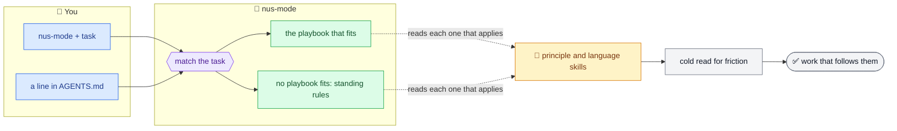
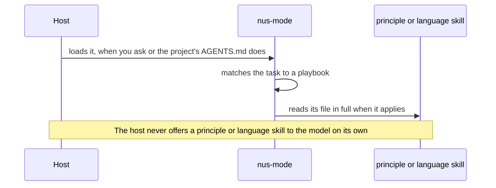

# nustack

[](https://github.com/Nusnus/nustack/actions/workflows/ci.yml)
[](https://github.com/Nusnus/nustack/releases)
[](https://devin.ai)
[](https://claude.com/claude-code)
[](https://cursor.com)
[](https://opencode.ai)
[](https://www.conventionalcommits.org)
[](LICENSE)

> **Trust a coding agent to work like a senior engineer while you're away.**

nustack carries Tomer Nosrati's way of building software into [Devin](https://devin.ai), [Claude Code](https://claude.com/claude-code), [Cursor](https://cursor.com) and [OpenCode](https://opencode.ai) as one mode, **nus-mode**, plus Steph Ango's Obsidian skills. Given a task, the mode follows the playbook that fits, if any, reads each principle and language skill that applies, and holds the result to them.

| | What you get |
| --- | --- |
| 🧭 **One mode** | One entry point to nustack's own skills: invoke `nus-mode` with a task, or add one line to a project's `AGENTS.md`. |
| 🎯 **One goal** | A low [friction rate](plugin/skills/nus-mode/SKILL.md#goal), which settles conflicts between principles. |
| 📋 **Playbooks** | Whole tasks as numbered steps, each ending on a checkable done condition. |
| 🧱 **Principles** | One skill each, read in full when the work needs it, and never restated elsewhere. |
| 🐍 **Languages** | One skill per language: its tools, and each principle's form in that language where it differs. |
| 📓 **Obsidian skills** | Steph Ango's Obsidian skills ([kepano/obsidian-skills](https://github.com/kepano/obsidian-skills)), shipped unchanged beside the mode. |
| ✅ **Checked like code** | `make check` enforces the skills' structure ([AGENTS.md › Checks](AGENTS.md#checks)). |

## 🔀 How it works



## 🚀 Quick start

### 1️⃣ Install

| Host | How |
| --- | --- |
| **Devin** | Add a plugin from the repository `Nusnus/nustack`, subdirectory `plugin`, as [Devin's plugin docs](https://docs.devin.ai/product-guides/plugins) describe; the install follows `main`, as [how updates roll out](https://docs.devin.ai/product-guides/plugins#how-updates-roll-out) says: a running session keeps what it loaded at start, and the Devin CLI takes the latest on `devin plugins update`. |
| **Devin, without repository access** | Someone with access downloads the zip of the release to install, `nustack-<version>.zip`, from the [releases page](https://github.com/Nusnus/nustack/releases) and uploads it as a zip plugin, as [Devin's plugin docs](https://docs.devin.ai/product-guides/plugins) describe; repeat for each new release. |
| **Claude Code** | Run the two commands below. |
| **Cursor** | Copy the `plugin` folder from a clone of this repository, or unzip `nustack-<version>.zip` from a [release](https://github.com/Nusnus/nustack/releases), to `~/.cursor/plugins/local/nustack`, then run **Developer: Reload Window**, as [Cursor's plugin docs](https://cursor.com/docs/plugins) describe; on Enterprise, an admin first allows local plugins, which are off by default. Where the plan offers team marketplaces, an admin can add this repository as a [team marketplace](https://cursor.com/docs/plugins#team-marketplaces) instead. |
| **OpenCode** | Run `opencode plugin add 'github:Nusnus/nustack#main::path:plugin'`, which installs `main`'s latest commit rather than a release. OpenCode keeps that install at startup; run `opencode plugin update` for a newer commit, as [OpenCode's plugin docs](https://opencode.ai/v2/docs/plugins/) say. |

```text
/plugin marketplace add Nusnus/nustack
/plugin install nustack@nustack
```

> [!TIP]
> Update a Claude Code install with `claude plugin update nustack@nustack`. To have it update itself, run `/plugin`, select the nustack marketplace on the **Marketplaces** tab, and select **Enable auto-update**, as [Keep plugins updated](https://code.claude.com/docs/en/discover-plugins#keep-plugins-updated) says.

### 2️⃣ Use

Invoke the mode with the task. In Claude Code:

```text
/nustack:nus-mode Start a CLI that tracks expenses.
/nustack:nus-mode Investigate why the nightly export times out.
/nustack:nus-mode Align this repository with nus-mode.
```

Devin uses the same [`/<plugin>:<skill>`](https://docs.devin.ai/desktop/devin-local/customizations) form: `/nustack:nus-mode <task>`. In [Cursor](https://cursor.com/docs/skills), type `/`, pick nus-mode, then write the task. In OpenCode, [mention](https://opencode.ai/v2/docs/skills/) it: `@nus-mode <task>`. Invoke any other skill the same way, such as `/nustack:obsidian-bases` in Claude Code and Devin, `/` then obsidian-bases in Cursor, or `@obsidian-bases` in OpenCode.

The agent works on its own once you say so, and offers to once it is highly confident it can; once it works on its own, it asks you only what nus-mode's [standing rules](https://github.com/Nusnus/nustack/blob/main/plugin/skills/nus-mode/SKILL.md#standing-rules) leave to you.

### 3️⃣ Turn it on for a project

Add this line to the project's `AGENTS.md` so each session whose host reads that file works in nus-mode. For Claude Code, which reads `AGENTS.md` only in some setups, also put `@AGENTS.md` in the project's `CLAUDE.md`, creating that file if needed, [as Claude Code's docs say](https://code.claude.com/docs/en/memory#agents-md). The new-project playbook does both for you, and the align playbook proposes them for an existing project.

```markdown
Work in this repository in nus-mode: load the skill before you start.
```

> [!IMPORTANT]
> The project's own rules come first: where they conflict with a principle or a language skill, the agent follows the project and says so, as nus-mode's [standing rules](plugin/skills/nus-mode/SKILL.md#standing-rules) say.

## 🧩 What's inside

### How the skills load

nus-mode loads the principle and language skills itself: its [SKILL.md](plugin/skills/nus-mode/SKILL.md) lists when each applies, and the agent reads each applicable skill's file in full.



| Skill | Can the model load it alone? | Frontmatter |
| --- | --- | --- |
| 🧭 nus-mode | ✅ Yes, so a project's `AGENTS.md` can turn it on | No `disable-model-invocation` or `triggers` |
| 🧱 `principle-*` and 🐍 `language-*` | 🚫 No: nus-mode reads it, and you can still invoke it by name | `disable-model-invocation: true` hides it in Claude Code, [Cursor](https://cursor.com/docs/skills) and, through the loader, OpenCode; `triggers: [user]` hides it in Devin |
| 📓 Obsidian skills | ✅ Yes, with or without nus-mode, where its description matches the task; invoke one by name, as [Use](#2️⃣-use) shows, to be sure it loads | Upstream's own, unchanged |

Because they are hidden, the principle and language skills stay out of the model's skill list and normally arrive through the mode, which brings the goal and the tie-break with them. A skill you invoke by name, or a file the model opens on its own, loads without the mode.

> [!NOTE]
> [pstack](https://github.com/cursor/plugins/tree/main/pstack) hides its principle skills with `disable-model-invocation: true` too.

### Skills

| Skill | What it holds |
| --- | --- |
| 🧭 [nus-mode](plugin/skills/nus-mode/SKILL.md) | The goal, the standing rules, and the index of every playbook, principle and language skill, with when each applies. |
| 🏷️ [principle-naming](plugin/skills/principle-naming/SKILL.md) | Names that say what a thing is in the domain. |
| ♻️ [principle-dry](plugin/skills/principle-dry/SKILL.md) | One home for every piece of knowledge. |
| 🛑 [principle-fail-fast](plugin/skills/principle-fail-fast/SKILL.md) | Code that stops where a problem starts, with an error that says how to recover. |
| 🚪 [principle-boundaries](plugin/skills/principle-boundaries/SKILL.md) | Outside data parsed once, where it enters, and an expected absence held as data. |
| 🔤 [principle-types](plugin/skills/principle-types/SKILL.md) | Types that hold the contract, so an invalid value cannot exist. |
| 🧩 [principle-design](plugin/skills/principle-design/SKILL.md) | A design that starts from proven patterns and SOLID objects, short because it fits the problem. |
| 🗂️ [principle-layout](plugin/skills/principle-layout/SKILL.md) | A folder and file layout that shows the design. |
| ➡️ [principle-dependencies](plugin/skills/principle-dependencies/SKILL.md) | Dependencies that point one way, one home for each library, the runtimes a project targets, a pinned lockfile, and deciding logic kept pure. |
| 🛟 [principle-resilience](plugin/skills/principle-resilience/SKILL.md) | Code that comes through a stalled or failing dependency, or a crash part way through. |
| ⏳ [principle-long-term](plugin/skills/principle-long-term/SKILL.md) | Changes built to last, so they are done once. |
| 🧪 [principle-deterministic-tests](plugin/skills/principle-deterministic-tests/SKILL.md) | Tests whose outcome depends only on their inputs, the same on every run and under any load. |
| 📖 [principle-self-explanatory-code](plugin/skills/principle-self-explanatory-code/SKILL.md) | Code that explains itself, and docs for what it cannot say. |
| 📝 [principle-pr-descriptions](plugin/skills/principle-pr-descriptions/SKILL.md) | PR descriptions a reviewer takes in at a glance. |
| 💬 [principle-responses](plugin/skills/principle-responses/SKILL.md) | Replies, status updates, questions and reports a person takes in at a glance. |
| 🐍 [language-python](plugin/skills/language-python/SKILL.md) | Python's tools, and where Python changes how a principle applies. |
| 📓 [obsidian-markdown](plugin/skills/obsidian-markdown/SKILL.md) | Obsidian Flavored Markdown. |
| 📓 [obsidian-bases](plugin/skills/obsidian-bases/SKILL.md) | Obsidian Bases, `.base` files. |
| 📓 [json-canvas](plugin/skills/json-canvas/SKILL.md) | JSON Canvas, `.canvas` files. |
| 📓 [obsidian-cli](plugin/skills/obsidian-cli/SKILL.md) | The Obsidian CLI. |
| 📓 [defuddle](plugin/skills/defuddle/SKILL.md) | Web pages to Markdown with the Defuddle CLI. |
| 📓 [knap](plugin/skills/knap/SKILL.md) | Markdown from Knap templates and data. |

nus-mode's [`SKILL.md`](plugin/skills/nus-mode/SKILL.md) is the index for nustack's own playbooks, principles and language skills, and [`vendored/obsidian-skills.json`](vendored/obsidian-skills.json) is the one for the Obsidian skills; this table shows them all at a glance.

## 🗂️ Layout

```text
nustack/
├── plugin/                     what installs
│   ├── .devin-plugin/          Devin manifest
│   ├── .claude-plugin/         Claude Code manifest
│   ├── .cursor-plugin/         Cursor manifest
│   ├── hooks/                  Claude Code hook, which reloads nus-mode after a summarization
│   ├── opencode.ts             OpenCode loader, which registers the skills and reloads nus-mode
│   ├── package.json            how OpenCode installs the loader
│   ├── LICENSE                 a copy of the repository's LICENSE
│   └── skills/
│       ├── nus-mode/           the mode and its playbooks
│       ├── principle-*/        one principle per skill
│       ├── language-*/         one language per skill
│       └── …                   the Obsidian skills, each named in vendored/obsidian-skills.json
├── .claude-plugin/             the Claude Code marketplace
├── .cursor-plugin/             the Cursor marketplace
├── src/nustack/                the harness and the `nustack` command
│   ├── cli/                    the `nustack` command and the parsers of its values
│   ├── release/                a plugin release, published on GitHub from its v<version> tag
│   ├── repository/             the files released and configured beside the plugin, the test suite's layout and the vendored copies, read from disk
│   ├── sync/                   the sync of each vendored copy: the copy, its review evidence and its pull request
│   ├── plugin/                 the rules the plugin, its skills and manifests keep, and its bundle
│   ├── markdown/               the Markdown documents are written in, down to a skill's frontmatter
│   └── github/                 GitHub: a repository's name and URL, and its pull requests and releases by gh
├── tests/                      unit, integration and smoke tests
├── .devin/blueprint.yaml       the Devin environment
├── .agents/skills/             skills for working on nustack
├── .claude/skills              a symlink to .agents/skills/, where Claude Code reads them
├── vendored/                   one record per vendored copy, which the sync workflow updates
├── package.json                the loader's tools; their config sits beside it
├── AGENTS.md                   the rules for changing nustack
├── REVIEW.md                   what Devin Review holds each pull request to
└── CHANGELOG.md
```

## 🤝 Contributing

Contributions follow [AGENTS.md](AGENTS.md), which holds the rules for changing nustack and what CI and the commit hooks check. The [release](.agents/skills/release/SKILL.md) skill holds the release steps. [REVIEW.md](REVIEW.md) says what review checks, and `make` lists the targets.

## 🙏 Acknowledgements

[pstack](https://github.com/cursor/plugins/tree/main/pstack) and its `poteto-mode`, from which nustack and nus-mode take their names and their structure: a mode that routes work to playbooks, with one skill per principle.

[AI Hero](https://www.aihero.dev) by Matt Pocock: nustack words the texts [AGENTS.md](AGENTS.md) names by his [writing-for-agents](.agents/skills/writing-for-agents/SKILL.md) skill. A scheduled workflow proposes changes from [his skills repository](https://github.com/mattpocock/skills) with a comparison to nustack's copy for the owner to [review](REVIEW.md).

[Steph Ango (kepano)](https://github.com/kepano): the plugin ships his [obsidian-skills](https://github.com/kepano/obsidian-skills) unchanged, each with its MIT license, and the same scheduled workflow proposes each upstream change.

## 📄 License

[MIT](LICENSE) © Tomer Nosrati
