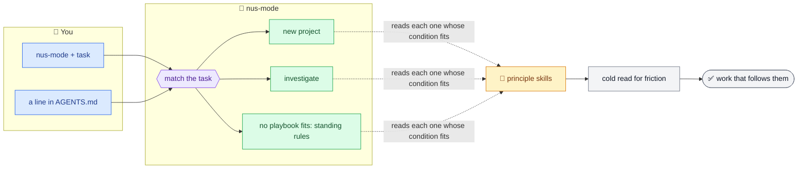
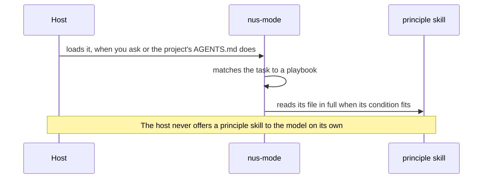

# nustack

[](https://github.com/Nusnus/nustack/actions/workflows/checks.yml)
[](https://github.com/Nusnus/nustack/releases/latest)
[](https://devin.ai)
[](https://claude.com/claude-code)
[](https://cursor.com)
[](https://opencode.ai)
[](https://www.conventionalcommits.org)
[](LICENSE)

> **Trust a coding agent to work like a senior engineer while you're away.**

nustack carries Tomer Nosrati's way of building software into [Devin](https://devin.ai), [Claude Code](https://claude.com/claude-code), [Cursor](https://cursor.com) and [OpenCode](https://opencode.ai) as one mode, **nus-mode**. Hand the agent a task: the mode follows the playbook that fits the task, if one does, reads each principle the work touches, and holds the result to them.

| | What you get |
| --- | --- |
| 🧭 **One mode** | One entry point: invoke `nus-mode` with a task, or add one line to a project's `AGENTS.md`, which Claude Code reads through an import in `CLAUDE.md`. |
| 🎯 **One goal** | A low friction rate, as [nus-mode](plugin/skills/nus-mode/SKILL.md#goal) defines it. It also settles any conflict between principles. |
| 📋 **Playbooks** | Whole tasks as numbered steps, each ending on a done condition the agent checks. |
| 🧱 **Principles** | One skill each, read in full when the work needs it, and never restated elsewhere. |
| ✅ **Checked like code** | `make check` holds the skills' structure, as [AGENTS.md › Checks](AGENTS.md#checks) lists. |

## 🔀 How it works



## 🚀 Quick start

### 1️⃣ Install

| Host | How |
| --- | --- |
| **Devin** | Add a plugin from the repository `Nusnus/nustack`, with `plugin` as its subdirectory, as [Devin's plugin docs](https://docs.devin.ai/product-guides/plugins) describe. Installs follow the repository's `main` branch, as [how updates roll out](https://docs.devin.ai/product-guides/plugins#how-updates-roll-out) says. |
| **Devin, without access to the repository** | Someone with access downloads `nustack-<version>.zip` from the [latest release](https://github.com/Nusnus/nustack/releases/latest), then uploads it through **Add plugin** → **Upload .zip**. Upload each new release the same way. |
| **Claude Code** | Run the two commands below. |
| **Cursor** | Copy the `plugin` folder to `~/.cursor/plugins/local/nustack`, [Cursor's folder for local plugins](https://github.com/cursor/plugins/blob/main/create-plugin/skills/create-plugin-scaffold/SKILL.md), or unzip a release there. On a Teams or Enterprise plan, an admin can add this repository as a [team marketplace](https://cursor.com/docs/plugins#team-marketplaces) instead. A public repository can also list in Cursor's marketplace, with a one-click Add to Cursor button. |
| **OpenCode** | Run `opencode plugin add 'github:Nusnus/nustack#main::path:plugin'`. |

```text
/plugin marketplace add Nusnus/nustack
/plugin install nustack@nustack
```

> [!TIP]
> Update a Claude Code install with `claude plugin update nustack@nustack`, or turn on auto-update for the nustack marketplace, which is off by default.

### 2️⃣ Use

Ask for the mode by name, with the task. In Claude Code:

```text
/nustack:nus-mode Start a CLI that tracks expenses.
/nustack:nus-mode Investigate why the nightly export times out.
```

Devin lists a plugin's skills as [`/<plugin>:<skill>`](https://docs.devin.ai/desktop/devin-local/customizations), so there it's `/nustack:nus-mode <task>` too. In [Cursor](https://cursor.com/docs/skills), type `/`, pick nus-mode, then write the task. OpenCode loads a skill you [mention](https://opencode.ai/v2/docs/skills/), so there it's `@nus-mode <task>`.

A new project stops once, early on, to agree its standards with you. After that, the agent works alone to the end.

### 3️⃣ Turn it on for a project

Add this line to the project's `AGENTS.md`, and each session whose host reads that file works in nus-mode. Claude Code reads `AGENTS.md` itself only in some setups, so for Claude Code also put `@AGENTS.md` in the project's `CLAUDE.md`, creating the file if needed, [as Claude Code's docs say](https://code.claude.com/docs/en/memory#agents-md). The new-project playbook writes the line for you.

```markdown
Work in this repository in nus-mode: load the skill before you start.
```

> [!IMPORTANT]
> The project's own rules come first: where they conflict with a principle, the agent follows the project and says so.

## 🧩 What's inside

### How the principles load

nus-mode loads the principles on its own. Its [SKILL.md](plugin/skills/nus-mode/SKILL.md) lists when each principle applies, and the agent reads that principle's file in full when its work meets the condition.



| Skill | Can the model load it alone? | Frontmatter |
| --- | --- | --- |
| 🧭 nus-mode | ✅ Yes, so a project's `AGENTS.md` can turn it on | Both settings left at their defaults |
| 🧱 `principle-*` | 🚫 No: nus-mode reads it, and you can still invoke it by name | `disable-model-invocation: true` hides it in Claude Code and [Cursor](https://cursor.com/docs/skills), the loader hides it in OpenCode, and `triggers: [user]` in Devin |

Hiding the principle skills keeps the host from offering them to the model, so a principle normally arrives through the mode, which brings the goal and tie-break, and the principles don't crowd the host's list of skills. A principle you invoke by name, or a file the model opens on its own, loads without the mode.

> [!NOTE]
> [pstack](https://github.com/cursor/plugins/tree/main/pstack) hides its principle skills with `disable-model-invocation: true` too.

### Skills

| Skill | What it holds |
| --- | --- |
| 🧭 [nus-mode](plugin/skills/nus-mode/SKILL.md) | The goal, the standing rules, and the playbooks: [new project](plugin/skills/nus-mode/playbooks/new-project.md) and [investigate](plugin/skills/nus-mode/playbooks/investigate.md). |
| 🏷️ [principle-naming](plugin/skills/principle-naming/SKILL.md) | Names that say what a thing is in the domain. |
| ♻️ [principle-dry](plugin/skills/principle-dry/SKILL.md) | One home for every piece of knowledge. |
| 🛑 [principle-fail-fast](plugin/skills/principle-fail-fast/SKILL.md) | Code that stops where a problem starts, with an error that says how to recover. |
| 🚪 [principle-boundaries](plugin/skills/principle-boundaries/SKILL.md) | Outside data parsed once, where it enters. |
| 🔤 [principle-types](plugin/skills/principle-types/SKILL.md) | Types that hold the contract, so an invalid value cannot exist. |
| 🗂️ [principle-layout](plugin/skills/principle-layout/SKILL.md) | A folder and file layout that shows the design. |
| ➡️ [principle-dependencies](plugin/skills/principle-dependencies/SKILL.md) | Dependencies that point one way, and one home for each library. |
| ⏳ [principle-long-term](plugin/skills/principle-long-term/SKILL.md) | Changes built to last, so they are done once. |
| 📖 [principle-self-explanatory-code](plugin/skills/principle-self-explanatory-code/SKILL.md) | Code that explains itself, and docs for what it cannot say. |
| 📝 [principle-pr-descriptions](plugin/skills/principle-pr-descriptions/SKILL.md) | PR descriptions a reviewer takes in at a glance. |

## 🗂️ Layout

```text
nustack/
├── plugin/                     what installs
│   ├── .devin-plugin/          Devin manifest
│   ├── .claude-plugin/         Claude Code manifest
│   ├── .cursor-plugin/         Cursor manifest
│   ├── opencode.ts             OpenCode loader, which registers the skills
│   ├── package.json            how OpenCode installs the loader
│   ├── LICENSE                 a copy of the repository's LICENSE
│   └── skills/
│       ├── nus-mode/           the mode and its playbooks
│       └── principle-*/        one principle per skill
├── .claude-plugin/             the Claude Code marketplace
├── .cursor-plugin/             the Cursor marketplace
├── src/nustack/                the harness and the `nustack` command
├── tests/                      the harness's tests and the loader's
├── .devin/blueprint.yaml       the Devin environment
├── package.json                the loader's tools, with tsconfig.json, biome.json and bunfig.toml
├── AGENTS.md                   the rules for changing nustack
├── REVIEW.md                   what Devin Review holds each pull request to
└── CHANGELOG.md
```

## 🤝 Contributing

Contributions follow [AGENTS.md](AGENTS.md), and [REVIEW.md](REVIEW.md) says what review checks. `make` lists the targets. Install the uv version `pyproject.toml` requires and the Bun version `package.json` pins, then run `make install` once: it also installs the commit hooks, which run the same checks as `make check` and check each commit message. Releases are tag-driven; [AGENTS.md](AGENTS.md) holds the steps.

## 🙏 Acknowledgements

[pstack](https://github.com/cursor/plugins/tree/main/pstack) and its `poteto-mode`: nustack and nus-mode are named after them, and follow their structure of a mode that routes work to playbooks, with one skill per principle.

[AI Hero](https://www.aihero.dev) by Matt Pocock: nustack's rules for writing skill text follow its guidance on writing for agents, such as stating the behaviour you want rather than the one to avoid.

## 📄 License

[MIT](LICENSE) © Tomer Nosrati
